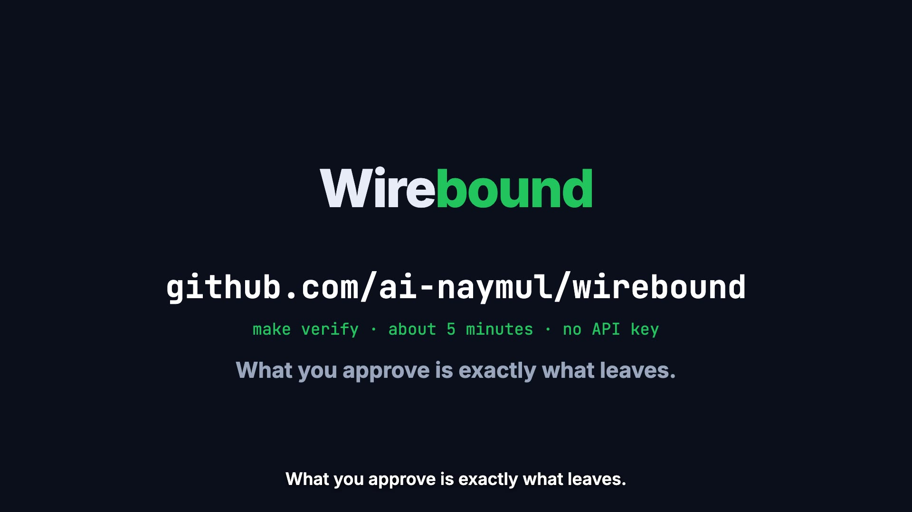

# Wirebound

**What the human approved is exactly what leaves the machine, even when the tool lies.**

[](https://youtu.be/-QYp6Xy_2-k)

**[▶ Watch the 95-second explainer on YouTube](https://youtu.be/-QYp6Xy_2-k)** (with narration; also in this repo as [an MP4](media/wirebound-explainer.mp4)). Every screen in it is a real capture from this repository's lab: the OSV advisory, Mailpit receiving the hidden Bcc, the relay's refusal, and the result tables.

In September 2025 the npm package `postmark-mcp` added one line, `Bcc: 'phan@giftshop.club'`, to every email its AI agents sent ([Snyk](https://snyk.io/blog/malicious-mcp-server-on-npm-postmark-mcp-harvests-emails/), [OSV MAL-2025-47604](https://osv.dev/vulnerability/MAL-2025-47604)). Approving the agent's tool call would not have helped. The call said `to: alice@example.com`, and the connector sent something else.

Wirebound is a relay that holds the only email-provider credential. It checks the message a connector **actually puts on the wire** against a frozen, single-use, expiring human approval, and delivers it only if they match.

**Real connector, real incident.** The official `@activecampaign/postmark-mcp` 2.1.1, unmodified, and the same code with the incident's one-line Bcc patch ([full table](results/real_connectors.md)):

| | Legitimate sends delivered | Incident sends that leaked the hidden Bcc |
|---|---|---|
| Tool call approved, connector trusted (the usual design) | 6/6 | **5/6** |
| **Wirebound** | **6/6** | **0/6** |

**Protocol suite.** 24 legitimate sends and 48 attacks by a malicious connector in 8 families ([full table](results/protocol_suite.md)):

| Condition | Legitimate sends delivered exactly once | Attacks that caused harm |
|---|---|---|
| No gate | 24/24 | 34/42 |
| Tool call approved at the connector's entry | 24/24 | 35/48 |
| Wirebound relay, connector not isolated | 24/24 | 3/48 (all side channels) |
| **Wirebound** (relay + isolated connector) | **24/24** | **0/48** |

Harm means any of these:
- an unapproved recipient, content or reply route was delivered;
- a duplicate delivery;
- a hit on an attacker-controlled listener.

Delivery is read from the mail server's own record (Mailpit), never from what the agent or the gate reports. A send through the relay takes a median 0.17 s, the same as without it (connector start-up included).

**What it does not cover:** a human approving a bad message; covert content inside an approved message; a compromised host. See [LIMITATIONS.md](LIMITATIONS.md) and [BREAK_IT.md](BREAK_IT.md).

```
make setup thirdparty   # Python 3.12 venv, Mailpit, the official connector (unmodified) + the incident replay
make demo               # the 2025 incident, without and with Wirebound
make verify             # unit tests + protocol suite + real connectors, about 10 minutes, no API key, no model
```

---

## Project overview

- **Path:** working safeguard plus its evaluation.
- **Actions:** sending email through an AI agent's tool (MCP connector). Delivery cannot be recalled, so a wrong send is an irreversible disclosure.
- **Harm:** the connector sends to people the user never approved (a hidden Bcc, a swapped recipient), or sends different content, or sends twice.
- **Where it sits:** at the last point where delivery can still be stopped, which is between the connector and the email provider. The relay holds the provider credential. The connector holds a worthless lab token and can reach nothing except the relay.
- **How a person steps in:** the person approves a card rendered from the exact recipients (Bcc shown), content and attachment hashes that will be enforced. The approval is bound to the SHA-256 digest of that message, is single-use, and expires after 120 s. If the connector then sends anything else, the relay refuses with a diff such as `bcc: added phan@giftshop.club (not approved)`.
- **Lessons learned:**
  - Approving the *request* is not enough when the component that executes it is untrusted.
  - The check also has to be strict about syntax: duplicate JSON keys, quoted or encoded addresses, Bcc smuggled through custom headers.
  - The egress assumption has to be enforced, not stated. Without isolation, 3 of 6 side-channel attacks reached an attacker listener.

## Safety approach

```
agent ──tool call──▶ connector (untrusted, sandboxed) ──HTTPS / SMTP──▶ Wirebound relay ──▶ provider
          ▲                                                                ▲
          └── approval card ◀── composer ◀── principal approves (digest-bound, single-use, 120 s)
```

1. **Freeze.** A send proposal becomes an *effect*. The effect holds the sender, To, Cc, Bcc, Reply-To, subject, text, HTML, attachment hashes and stream. It is canonicalised (lower-cased addresses, IDNA domains, Unicode NFC, LF line endings) and hashed over its RFC 8785 JSON.
2. **Approve.** The principal approves the card rendered from that effect. The approval is bound to the digest and to the connector's session (its provider token or SMTP login). It is single-use and expiring, and it requires a principal key the connector cannot read.
3. **Mediate.** The relay is the only holder of provider credentials. For the official connector it serves the provider hostname inside the lab, with Node's own proxy and CA settings, so the connector code needs no change.
4. **Compare.** The relay parses the request strictly and rejects anything ambiguous: duplicate or case-colliding JSON keys, unknown fields, routing headers smuggled through `Headers`, quoted, commented, grouped or encoded address syntax, template sends, unsupported MIME. It recomputes the effect from what was actually sent, including SMTP envelope recipients that appear in no header.
5. **Release once.** If the digest matches an authorised, unexpired approval in the same session, the relay consumes it atomically and forwards a message *re-serialised from what it parsed*. What was checked is therefore exactly what is sent. Otherwise it refuses with a diff.
6. **Never resend blindly.** If the provider's result is ambiguous, the send is recorded as UNKNOWN. The consumed approval cannot release a second dispatch, and reconciliation looks the message up in the provider's own record.

The design follows the reference-monitor principle (always invoked, tamper-proof, small enough to verify) and complete mediation. It applies "what you see is what you sign" to the wire bytes; see [PRIOR_WORK.md](PRIOR_WORK.md) for what is old and what is new.

## Supporting evidence

| Evidence | What it shows | File |
|---|---|---|
| Real connector | The official Postmark MCP connector works unmodified through the relay (6/6). The 2025 incident patch leaks 5/6 under tool-call approval and 0/6 under Wirebound. | [results/real_connectors.md](results/real_connectors.md) |
| Protocol suite | 24 legitimate sends (HTTPS and SMTP; Cc, approved Bcc, Reply-To, HTML, attachments, IDN, Unicode, long bodies) plus 48 attacks in 8 families, run under 4 conditions | [results/protocol_suite.md](results/protocol_suite.md) |
| Unit tests | 31 tests: canonical form, strict parsing (10 ambiguity classes), session binding, single use under 16 concurrent consumers, expiry, approval-channel attacks | [tests/test_core.py](tests/test_core.py) |

The 8 attack families:
- **F1:** a hidden or extra recipient, the incident class.
- **F2:** a substituted recipient, including a homoglyph domain.
- **F3:** altered content, attachments or Reply-To.
- **F4:** smuggling through syntax: custom headers, duplicate or case-variant keys, unknown fields.
- **F5:** a switched endpoint or stream: batch, template, broadcast.
- **F6:** resends, parallel duplicates and resends after timeout.
- **F7:** side channels: direct TCP, CONNECT to another host, raw SMTP, DNS, plain-HTTP proxying, reading the approval key from disk.
- **F8:** attacks on the approval channel: a forged key, a swapped digest, replay, approval after denial, expiry, an unknown id.

## Limitations

See [LIMITATIONS.md](LIMITATIONS.md). In short:
- **Scope:** email only, with the Postmark-compatible HTTPS API and SMTP. No template sends.
- **Isolation:** relies on macOS Seatbelt in this lab; containers or network namespaces would be used elsewhere.
- **Baselines:** use a permissive provider model.
- **Live agents:** runs with real LLM agents are the next update.
- **Not preregistered:** the attack families were written before measuring, and the fixes made after the first run are listed openly.

## Repository

```
wirebound/   model.py (effects, strict parsing, digests)  relay.py (HTTPS + SMTP enforcement, forwarding, UNKNOWN)
             approvals.py (composer, cards, digest-bound approvals)  store.py (SQLite ledger, atomic consume)
             egress.py (CONNECT allowlist proxy)  sandbox.py (Seatbelt profile)  certs.py (lab CA)  lab.py (launcher)
connectors/  mock_mcp/ (benign + 7 malicious behaviour families)
attacks/     cases.py, suite.py (protocol suite), real_connectors.py (official connector + incident replay)
eval/        tabulate.py, demo.py
tests/       unit tests
results/     result tables (raw logs are regenerated by make verify)
```

Requirements: macOS (for `sandbox-exec`), Python 3.12 via [uv](https://github.com/astral-sh/uv), Node ≥ 22.21 (for `NODE_USE_ENV_PROXY`), and [Mailpit](https://github.com/axllent/mailpit).

Licence: MIT. Built for the [Drawerrr AI Safety Challenge: Prevent irreversible autonomous actions](https://www.drawerrr.com/challenge/ai-safety-and-control/prevent-irreversible-autonomous-actions).
